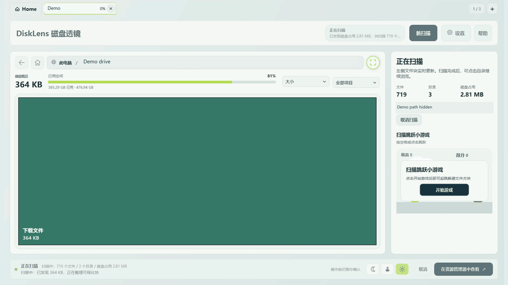
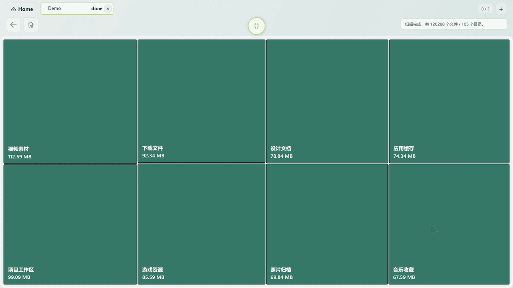
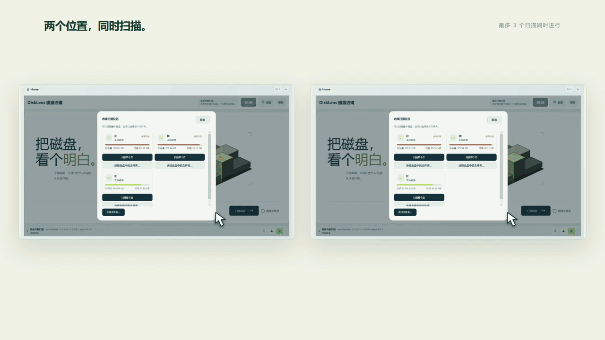

# DiskLens

**See your space. Organize with confidence.**

A visual disk space analyzer for Windows, with concurrent scans and optional AI assistance.

[Website & download](https://disklens.site/) · [Latest release](https://github.com/kxdyh/Disklens/releases/latest) · [Feedback](https://github.com/kxdyh/Disklens/issues) · [简体中文](README.md)

Windows 10 / 11 · x64 · Currently closed source

## Find a starting point for organizing your disk

DiskLens turns the disk usage of files and folders into rectangular blocks. Find the largest areas, navigate into folders, and compare their sizes before deciding what to do next.

| Feature | What you can do |
| --- | --- |
| Visual disk usage | Scan a drive or folder and watch the space map update as the scan progresses |
| Scan report | Review read errors and their causes; whole-drive reports list Windows system-reserved space and the remaining difference |
| Concurrent scans | Run up to 3 scans at once and switch between them using tabs |
| Folder navigation & pagination | See the top 50 items at each level, then page through the remaining items |
| Focus view | Expand the space map for full-screen browsing |
| Light & dark themes | Choose the appearance that suits your workspace |
| Optional AI assistance | Configure your own DeepSeek or OpenAI-compatible service and explicitly request an analysis |

Progress is calculated as deduplicated scanned disk usage divided by the drive's used space at the start of the scan. Folder scans use the containing drive's used space as well. `done` means the selected location has been fully traversed. System-reserved space, NTFS metadata, restricted directories, and changes during a scan may leave a difference, so a completed scan does not necessarily show 100%.

## See it in action

These landscape recordings show the app in light and dark themes. They have been edited, sped up, and masked to hide local workspace paths. Scan times shown here are demonstrations, not benchmarks; interface details may differ from the current release.

**Focus view: navigate from a large folder into its contents.**

**Concurrent scans: scan two locations and switch between their progress and results.**

## Download & get started

1. Get the Windows x64 release from the [website](https://disklens.site/) or [GitHub Releases](https://github.com/kxdyh/Disklens/releases/latest).
2. Close the previous version, **extract the entire ZIP into a folder**, then run `DiskLens.App.exe` and accept the administrator prompt. Keep the accompanying instructions and AI prompt template in that folder.
3. Choose a drive or folder to scan, then browse its space usage when the scan finishes.
4. To use AI assistance, configure your own service endpoint, model, and API key in Settings, then explicitly request an analysis.

The release targets Windows 10 / 11 x64 and includes its runtime; no separate .NET installation is needed. Check the corresponding release notes for its version and file checksums. The extracted program contents are also available in [`distribution/win-x64/`](distribution/win-x64/).

## Data & file operations

- **Scanning runs locally.** You can scan and browse disk usage without using AI.
- **AI is optional.** The configured service is called only when you explicitly request analysis. Relevant analysis information is sent to that service; review its data policy before use.
- **Bring your own API key.** Never post keys, complete personal paths, or sensitive file information in an issue.
- **DiskLens does not automatically delete files.** AI output is advisory. Verify a file's purpose and back up important data before organizing it.

## Report a problem or suggest a feature

Anyone with a GitHub account is welcome to use [Issues](https://github.com/kxdyh/Disklens/issues) to report a bug, suggest a feature, or ask a usage question. Include the app version, Windows version, reproduction steps, and screenshots with sensitive information removed.

For size discrepancies, include the scan scope, the comparison tool, and whether you are comparing logical size, allocated space, or the drive's total used space.

If you cannot access Issues, or your report contains information unsuitable for public sharing, contact **[2297782581@qq.com](mailto:2297782581@qq.com)**.

## About this repository

This repository hosts DiskLens releases, product documentation, demos, and feedback. **DiskLens is currently closed source. Product source code is not included, and no open-source license is granted.** See [NOTICE.md](NOTICE.md) for the copyright and third-party notice.

By [kxdyh](https://github.com/kxdyh) · [disklens.site](https://disklens.site/)
