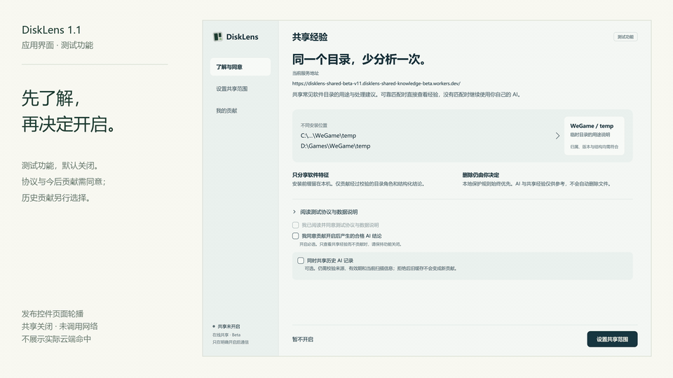
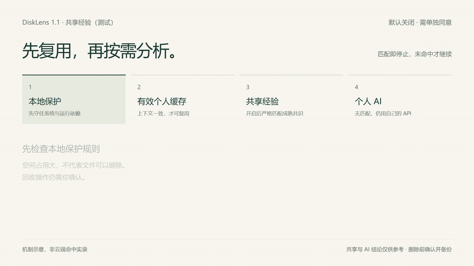

# DiskLens

**See your space. Organize with confidence.**

A visual disk space analyzer for Windows, with concurrent scans and optional AI assistance.

[Website & download](https://disklens.site/) · [Latest release](https://github.com/kxdyh/Disklens/releases) · [Changelog & history](CHANGELOG.en.md) · [Feedback](https://github.com/kxdyh/Disklens/issues) · [简体中文](README.md)

Windows 10 / 11 · x64 · Currently closed source

## Find a starting point for organizing your disk

DiskLens turns the disk usage of files and folders into rectangular blocks. Find the largest areas, navigate into folders, and compare their sizes before deciding what to do next.

| Feature | What you can do |
| --- | --- |
| Visual disk usage | Scan a drive or folder and watch the space map update as the scan progresses |
| Scan report | Review read errors and their causes; whole-drive reports list Windows system-reserved space and the remaining difference |
| Concurrent scans | Run up to 3 scans at once and switch between them using tabs |
| Folder navigation & pagination | See the top 50 items at each level, then page through the remaining items |
| Focus view | Expand the space map for full-screen browsing |
| Light & dark themes | Choose the appearance that suits your workspace |
| AI assistance | Analyze the scan root or current folder, with progress, elapsed time, Token usage and cost estimates |
| Automatic file updates | Reflect external additions, deletions, renames and file-size changes in the map |
| Release notifications | From 1.1 onward, check for newer releases at startup; dismiss or skip only a specific version |

Progress is calculated as deduplicated scanned disk usage divided by the drive's used space at the start of the scan. Folder scans use the containing drive's used space as well. `done` means the selected location has been fully traversed. System-reserved space, NTFS metadata, restricted directories, and changes during a scan may leave a difference, so a completed scan does not necessarily show 100%.

## See it in action

These landscape recordings show the app in light and dark themes. They have been edited, sped up, and masked to hide local workspace paths. Scan times shown here are demonstrations, not benchmarks; interface details may differ from the current release.

**Focus view: navigate from a large folder into its contents.**

**Concurrent scans: scan two locations and switch between their progress and results.**

## What is new in 1.1

- **Choose the scope.** Analyze the scan root or the current real folder and its descendants, beyond the 50 items visible on screen.
- **See the work in progress.** View processed items, activity, elapsed time and a cancel action while the model responds.
- **Know the usage.** View API-reported Token usage and estimated prices for verified official DeepSeek models. Unchanged items reuse the local analysis cache without another request.
- **Keep the map current.** File changes made in Explorer automatically update affected blocks, sizes and outdated AI conclusions, without a manual refresh.
- **Install and stay up to date.** A Windows installer is now available. Update checks start with 1.1; skipping one version does not suppress later releases. Existing 1.0 users need to upgrade manually once.

### Shared experience (test): reduce repeated analysis

Shared experience is **off by default**. When enabled, the order is local protection → valid personal cache → shared experience → personal AI. Reuse requires a verified software identity, matching major version, root-relative directory role and complete allowlisted structure. A matching name or similar path is insufficient. Initial support covers controlled structures for Android SDK temporary files, emulator runtime dependencies and WeGame temporary files. Unmatched folders or folders without mature evidence still need your own API.

Before enabling, read the agreement, consent to future contributions and preview the scope. **Historical contributions are a separate choice.** Exclude folders, review contributions, or withdraw one or all; exclusions also cover descendants and related parent summaries. The cloud stores controlled directory roles, structured conclusions and the minimum fields needed for consent, withdrawal and replay prevention, rather than file contents, full personal paths or free-text reasons. Exportable management credentials support recovery; keep them secure.

Consensus requires at least **5 eligible installation identifiers, 72 hours of observation and 90% agreement**, with conflict checks. Installation identifiers do not prove independent people. **More eligible contributions may reduce repeated API costs for supported, reliably matched directories; full coverage or zero cost is not guaranteed.** Shared and AI conclusions can be wrong. Confirm and back up before recycling files.

The actual test cloud currently has **0 contributions and 0 experience buckets**. Of 437 audited legacy personal AI entries, **0 qualified for historical contribution**; missing evidence is not fabricated. The isolated mature fixture matched 54/60 synthetic role variants, **not a real-disk coverage rate** or evidence already available online. [Test boundaries](SHARED-EXPERIENCE.en.md) · [Website mechanism illustration](https://disklens.site/#shared-experience)

Actual release-control page slideshow: sharing remains off, no network is called, and no real cloud hit is shown.

[Consent screenshot](assets/demos/shared-light-intro.png) · [Agreement screenshot](assets/demos/shared-light-agreement.png) · [Scope screenshot](assets/demos/shared-light-scope.png) · [Contribution management screenshot](assets/demos/shared-light-manage.png). Dark theme: [Consent](assets/demos/shared-dark-intro.png) · [Agreement](assets/demos/shared-dark-agreement.png) · [Scope](assets/demos/shared-dark-scope.png) · [Contributions](assets/demos/shared-dark-manage.png)

The following animation **illustrates the mechanism**. It is not a recorded cloud hit or a recording of the sharing interface:

### What did real AI analysis cost?

A later user-provided deepseek-flash billing screenshot showed approximately **CNY 0.11** for 14:00–15:00. Per-request reconciliation was not available, so it cannot be matched one-to-one to the historical candidates below. **The following figures are historical API usage and estimates using the rates at that time, not actual billed charges.**

Measured on 2026-11-06 UTC and verified at 00:16 on November 7 in Beijing time, using DeepSeek Flash, medium thinking, Token-saving mode, a 1 GiB candidate threshold and an empty analysis cache for each drive:

| Drive | New analysis candidates | Actual Tokens | Estimated off-peak / peak cost (CNY) |
| --- | ---: | ---: | ---: |
| C: | 26 | 4,672 | ¥0.015–0.030 |
| D: | 192 | 37,798 | ¥0.126–0.252 |
| E: | 215 | 46,361 | ¥0.155–0.311 |
| Total | **433** | **88,831** | about ¥0.30–0.59 |

The measured calls took place off-peak, giving an estimate of CNY 0.30 at that rate. Peak figures in the table are a same-usage comparison, not a range of actual charges. There were 23 successful requests: 19,658 input and 69,173 output Tokens, with output representing about 78% of the total and thinking included only once. Estimates use the [official DeepSeek rates](https://api-docs.deepseek.com/quick_start/pricing/) at the time of testing, rather than a billing-account transaction record. **Cost depends on the candidates and model input/output, not a fixed price per disk size. This is not the cost of individually analyzing every file on those drives.** Actual charges depend on the provider; local cache reuse sends no new request.

Choose the current folder to reduce the scope when you only need to inspect one location. The current SDK-folder example uses a **128 MiB threshold**: 16 candidates, one real request, and 3,185 Tokens (589 input and 2,596 output, including thinking). At the off-peak rate during the call, the estimate is **CNY 0.010973 (about 1.1 fen)**; the same usage would be CNY 0.021946 at the peak rate. This is separate from the historical three-drive test above, which used a 1 GiB threshold. Only file metadata was sent, not file contents. The temp/cache.tmp file recycled in the automatic-update demo is a self-created 1.25 GiB temporary sample. The input/output mix affects pricing, so 88,831 Tokens do not have a fixed CNY 0.30 price.

## Changelog & previous releases

| Version | Date | Highlights | Download |
| --- | --- | --- | --- |
| **[1.1.0](https://github.com/kxdyh/Disklens/releases/tag/v1.1.0)** | 2026-11-07 | Shared experience (test), cache hardening, scoped AI, automatic updates, installer | [Installer](https://assets.disklens.site/releases/1.1.0/DiskLens-Setup-1.1.0-x64.exe) · [Portable ZIP](https://assets.disklens.site/releases/1.1.0/DiskLens-1.1.0-win-x64.zip) |
| [1.0.0 preview](https://github.com/kxdyh/Disklens/releases/tag/v2026.11.06-preview) | 2026-11-06 | Space map, concurrent scans, folder navigation, scan reports and optional AI | [Archived ZIP](https://github.com/kxdyh/Disklens/releases/download/v2026.11.06-preview/DiskLens-win-x64-latest.zip) |

[Full changelog](CHANGELOG.en.md) · [Website archive](https://disklens.site/#releases)

## Download & get started

1. Get the Windows x64 **installer** from the [website](https://disklens.site/#download) or [GitHub Releases](https://github.com/kxdyh/Disklens/releases/latest).
2. Close the running app and follow `DiskLens-Setup-1.1.0-x64.exe` to install. Alternatively, **extract the entire portable ZIP into a folder**, then run `DiskLens.App.exe` with all accompanying files retained. The app requires administrator permission when launched.
3. Choose a drive or folder to scan, then browse its space usage when the scan finishes.
4. To use AI assistance, configure your own service endpoint, model, and API key in Settings, then explicitly request an analysis.

**Manual download for same-version upgrades:** this sharing update remains 1.1.0. An older 1.1.0 build will not prompt for it. Close the app and install this build manually. Sharing uses a separate HTTPS Beta service and may be rate-limited.

The release targets Windows 10 / 11 x64 and includes its runtime; no separate .NET installation is needed. Check the corresponding release notes for its version and file checksums. The extracted program contents are also available in [`distribution/win-x64/`](distribution/win-x64/).

## Data & file operations

- **Scanning runs locally.** You can scan and browse disk usage without using AI.
- **AI is optional.** The configured service is called only when you explicitly request analysis. Relevant analysis information is sent to that service; review its data policy before use.
- **Shared experience requires separate consent.** Off by default; when enabled, queries and contributions contact the experience service. Set exclusions or withdraw contributions. History is opt-in separately; unmatched directories still need your own API.
- **Bring your own API key.** Never post keys, complete personal paths, or sensitive file information in an issue.
- **DiskLens does not automatically delete files.** AI analysis is for reference only and may misclassify files. Confirm each file's purpose and back up important data before deleting anything. Take extra care with system files and application dependencies.

## Report a problem or suggest a feature

Anyone with a GitHub account is welcome to use [Issues](https://github.com/kxdyh/Disklens/issues) to report a bug, suggest a feature, or ask a usage question. Include the app version, Windows version, reproduction steps, and screenshots with sensitive information removed.

For size discrepancies, include the scan scope, the comparison tool, and whether you are comparing logical size, allocated space, or the drive's total used space.

If you cannot access Issues, or your report contains information unsuitable for public sharing, contact **[kxdyongheng@gmail.com](mailto:kxdyongheng@gmail.com)**.

## About this repository

This repository hosts DiskLens releases, product documentation, demos, and feedback. **DiskLens is currently closed source. Product source code is not included, and no open-source license is granted.** See [NOTICE.md](NOTICE.md) for the copyright and third-party notice.

By [kxdyh](https://github.com/kxdyh) · [disklens.site](https://disklens.site/)

[Support DiskLens](https://ifdian.net/a/kxdyh)
