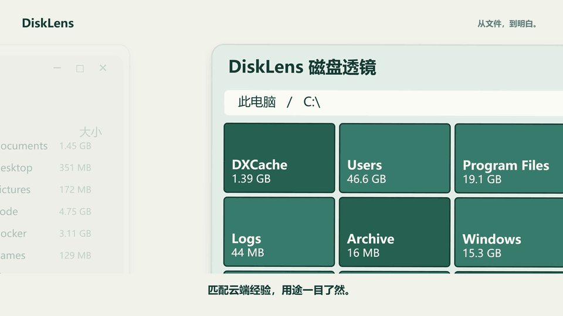
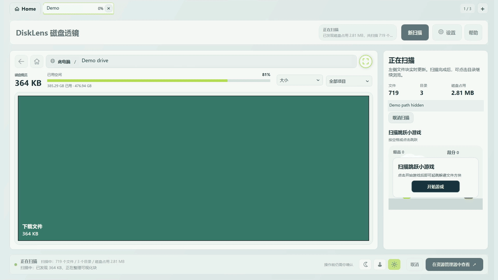
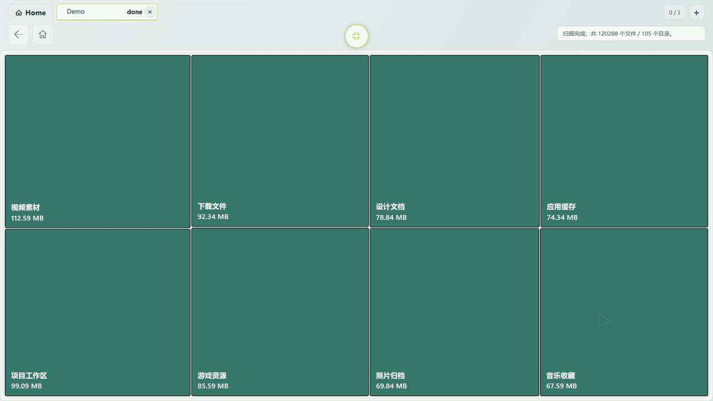
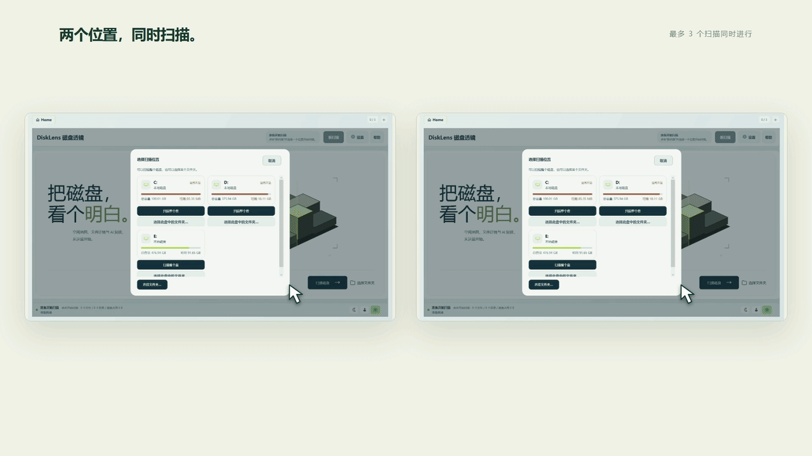

<div align="center">

# DiskLens

**See your space. Organize with confidence.**

A visual disk space analyzer for Windows, with concurrent scans and optional AI assistance.

[Website & download](https://disklens.site/) · [Release history](https://github.com/kxdyh/Disklens/releases) · [Feedback](https://github.com/kxdyh/Disklens/issues) · [简体中文](README.md)

Windows 10 / 11 · x64 · Free for noncommercial use

</div>

> **Current version: 1.1.2.** [Download from the official website](https://disklens.site/) · [Changelog](CHANGELOG.en.md). The [1.0.0 preview](https://github.com/kxdyh/Disklens/releases/tag/v2026.11.06-preview) remains available in release history.



Cloud experience adds purpose labels to matching blocks. Double-click to browse a folder, hover for a summary, or click for detailed analysis. This animation is an excerpt from the product film. Cloud experience is opt-in, and results appear only for successfully matched items.

## Find a starting point for organizing your disk

DiskLens turns the disk usage of files and folders into rectangular blocks. Find the largest areas, navigate into folders, and compare their sizes before deciding what to do next.

| Feature | What you can do |
| --- | --- |
| Visual disk usage | Scan a drive or folder and watch the space map update as the scan progresses |
| Scan report | Review read errors and their causes; whole-drive reports list Windows system-reserved space and the remaining difference |
| Concurrent scans | Run up to 3 scans at once and switch between them using tabs |
| Folder navigation & pagination | See the top 50 items at each level, then page through the remaining items |
| Focus view | Expand the space map for full-screen browsing |
| Light & dark themes | Choose the appearance that suits your workspace |
| Optional AI assistance | Configure your own DeepSeek or OpenAI-compatible service and explicitly request an analysis |

Progress is calculated as deduplicated scanned disk usage divided by the drive's used space at the start of the scan. Folder scans use the containing drive's used space as well. `done` means the selected location has been fully traversed. System-reserved space, NTFS metadata, restricted directories, and changes during a scan may leave a difference, so a completed scan does not necessarily show 100%.

## See it in action

These landscape recordings show the app in light and dark themes. They have been edited, sped up, and masked to hide local workspace paths. Scan times shown here are demonstrations, not benchmarks; interface details may differ from the current release.

**Scanning & themes: scan disk usage and switch between light and dark appearances.**



**Focus view: navigate from a large folder into its contents.**



**Concurrent scans: scan two locations and switch between their progress and results.**



## Download & get started

1. Download the current Windows x64 installer from the [website](https://disklens.site/).
2. Close any running DiskLens instance and run the installer. For an older ZIP release, extract it fully before running `DiskLens.App.exe`.
3. Choose a drive or folder to scan, then browse its space usage when the scan finishes.
4. To use AI assistance, configure your own service endpoint, model, and API key in Settings, then explicitly request an analysis.

The package includes its runtime and supports Windows 10 / 11 x64. Shared experience is off by default; see [how matching and privacy work](SHARED-EXPERIENCE.en.md).

## Data & file operations

- **Scanning runs locally.** You can scan and browse disk usage without using AI.
- **AI is optional.** The configured service is called only when you explicitly request analysis. Relevant analysis information is sent to that service; review its data policy before use.
- **Bring your own API key.** Never post keys, complete personal paths, or sensitive file information in an issue.
- **DiskLens does not automatically delete files.** AI output is advisory. Verify a file's purpose and back up important data before organizing it.

## Report a problem or suggest a feature

Anyone with a GitHub account is welcome to use [Issues](https://github.com/kxdyh/Disklens/issues) to report a bug, suggest a feature, or ask a usage question. Include the app version, Windows version, reproduction steps, and screenshots with sensitive information removed.

For size discrepancies, include the scan scope, the comparison tool, and whether you are comparing logical size, allocated space, or the drive's total used space.

If you cannot access Issues, or your report contains information unsuitable for public sharing, contact **[kxdyongheng@gmail.com](mailto:kxdyongheng@gmail.com)**.

## Source code and license

DiskLens is **free for noncommercial use**. The DiskLens source in this repository is provided under the [PolyForm Noncommercial License 1.0.0](LICENSE). Commercial use requires separate permission from the author; see [NOTICE.md](NOTICE.md) for contact details. AI providers may charge separately for their services.

- [Windows client](src/DiskLens.App) and [scanning and analysis core](src/DiskLens.Core)
- [Public cloud experience service](services/shared-knowledge)
- [Website contribution statistics](services/site-stats): anonymous aggregate snapshots refreshed twice daily.
- [English user guide](docs/releases/1.1-UserGuide.en.md) · [中文使用指南](docs/releases/1.1-使用说明.md)

### Build the Windows client

On Windows, install a .NET 8 SDK compatible with `global.json`, then run from the repository root:

```powershell
dotnet build DiskLens.sln -c Release
dotnet publish src/DiskLens.App/DiskLens.App.csproj -c Release -r win-x64 --self-contained true -o artifacts/win-x64
```

`artifacts/win-x64/DiskLens.App.exe` is the standalone source build. Include [LICENSE](LICENSE) and [NOTICE.md](NOTICE.md) when redistributing it.

### Privately maintained components

The author maintains a private operations console only to publish releases and announcements and control new enrollments in cloud experience sharing. Enrollment controls do not affect existing participants. Neither the console nor its management credentials ships with the source or user installer.

The official release's donation component and reward code are maintained separately. Source builds still build and provide the core features. To prevent payment destination changes, the author maintains the official donation entry directly and does not accept pull requests that change it.

By [kxdyh](https://github.com/kxdyh) · [disklens.site](https://disklens.site/)


[Support DiskLens (open the reward-code image)](https://disklens.site/media/author-reward.png)
