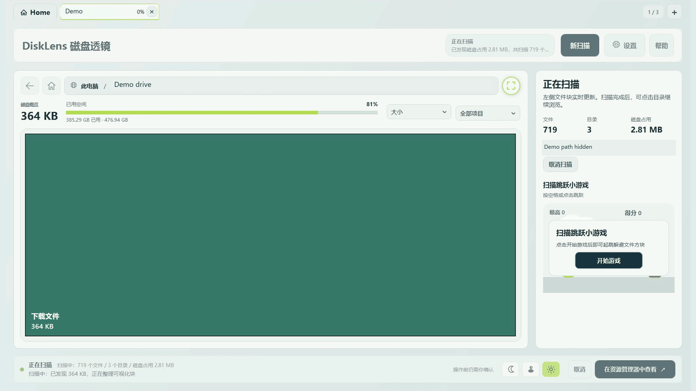
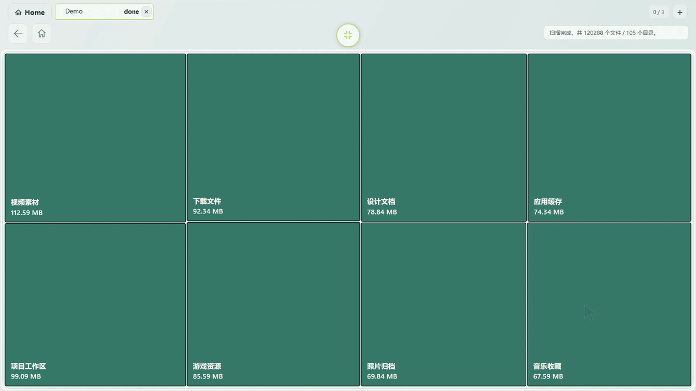
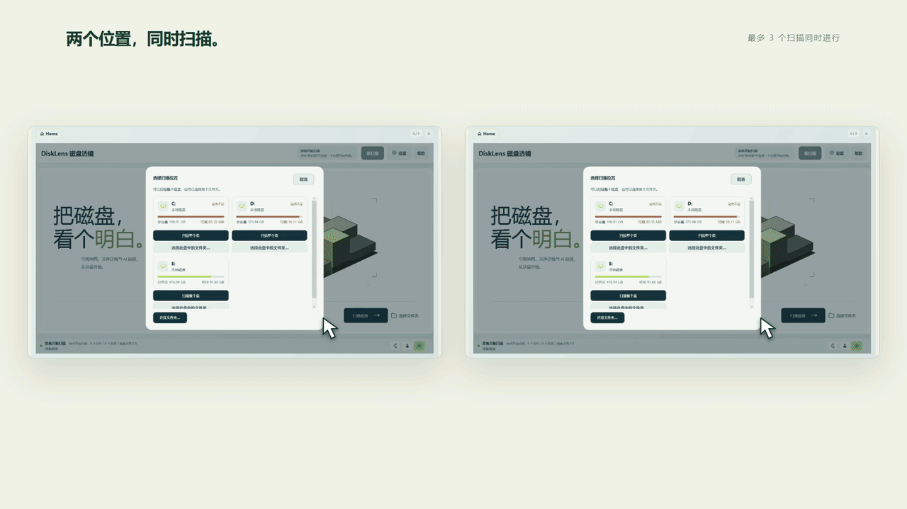
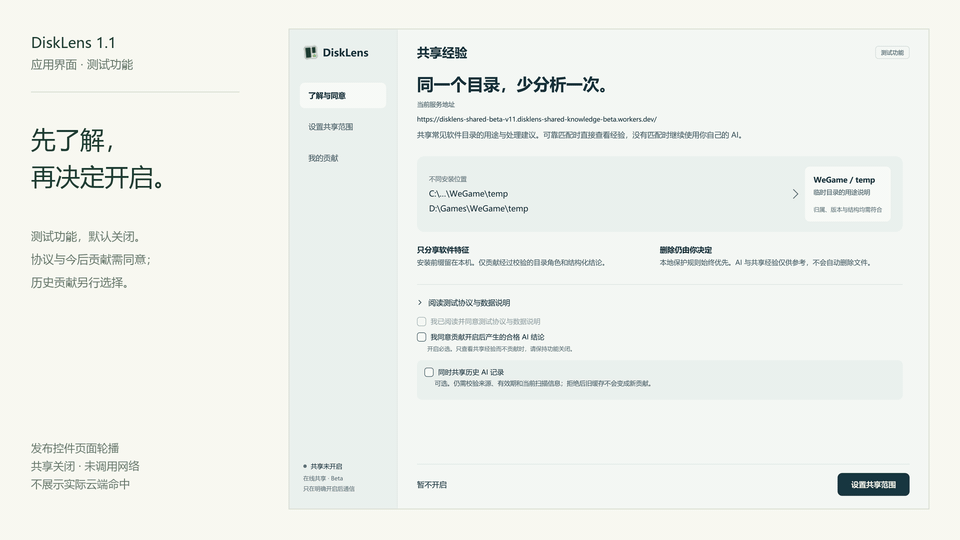
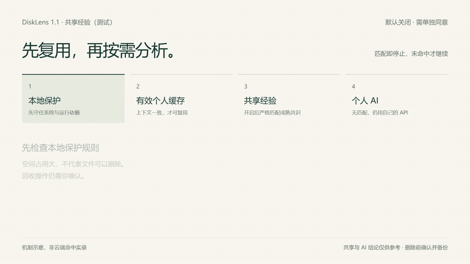

# DiskLens · 磁盘透镜

**看清空间，从容整理。**

Windows 磁盘空间可视化工具，支持多任务扫描与可选的 AI 辅助分析。

[官网与下载](https://disklens.site/) · [最新版本](https://github.com/kxdyh/Disklens/releases) · [更新记录与历史版本](CHANGELOG.md) · [问题反馈](https://github.com/kxdyh/Disklens/issues) · [English](README.en.md)

Windows 10 / 11 · x64 

## 从空间占用，找到整理的起点

DiskLens 将文件与文件夹的磁盘占用绘制为矩形方块。先找到占用较大的位置，再逐层查看目录、比较大小，决定下一步如何处理。

| 功能 | 使用方式 |
| --- | --- |
| 磁盘空间可视化 | 扫描磁盘或文件夹，随着扫描进度更新占用视图 |
| 扫描报告 | 查看读取问题及原因，整盘扫描中单列 Windows 系统预留与剩余差额 |
| 多任务扫描 | 最多同时运行 3 个扫描任务，通过顶部标签切换查看 |
| 分层浏览与分页 | 每层优先呈现前 50 项，其余项目通过分页继续查看 |
| 专注视图 | 将空间图切换到全屏专注浏览，减少界面干扰 |
| 日夜主题 | 按使用习惯选择浅色或深色界面 |
| AI 辅助分析 | 自选根目录或当前目录范围，查看进度、耗时、Token 与费用估算 |
| 自动同步文件变化 | 外部新增、删除、改名或修改大小后，文件块与容量自动更新 |
| 后续版本更新提醒 | 从 1.1 开始，启动后检查最新版；可关闭或只忽略某次更新 |

进度按「已扫描的去重磁盘占用 ÷ 扫描开始时所在磁盘的已用空间」计算，文件夹扫描也使用所在磁盘已用空间作为分母。`done` 表示所选位置遍历完成；系统预留、NTFS 元数据、受限目录及扫描期间的空间变化，都可能使扫描占用与磁盘已用空间存在差额，因此完成时不一定显示 100%。

## 实机演示

以下为横屏录制的应用演示，每张动图依次展示浅色与深色界面。为便于阅读，录屏经过剪辑、变速和本机工作区路径遮盖；其中的扫描时长不代表性能基准，界面细节以当前发布版本为准。

**专注浏览：从大目录进入下一层。**

**多任务：同时扫描两个位置，切换查看各自的进度与结果。**

## 1.1 更新：让 AI 成为看懂空间的下一步

- **按范围分析。** 分析整个扫描根目录，或当前打开的真实文件夹及其子目录；不限于画面上可见的 50 项。
- **等待有反馈。** 显示已处理项目、持续活动、已用时与取消入口。
- **消耗看得见。** 记录实际接口 Token 用量，对已核验的 DeepSeek 官方模型显示费用估算。未改变的项目复用本地缓存，不重复请求。
- **文件变化自动跟上。** 在资源管理器中整理后，文件块、容量和失效的 AI 结论会自动同步；不需要手动刷新。
- **安装与更新更方便。** 新增 Windows 安装器；从 1.1 开始内置更新检测，忽略某版本不会屏蔽之后的更高版本。已发布的 1.0 需先手动升级一次。

### 共享经验（测试）：减少相同目录的重复分析

共享经验**默认关闭**。启用后按「本地保护 → 有效个人缓存 → 共享经验 → 个人 AI」依次处理；共享经验只复用已验证的软件身份、主版本、根相对目录角色和完整结构白名单均匹配的受支持目录，不能仅凭同名或路径相似复用。首期支持 Android SDK 临时目录、模拟器运行目录及 WeGame 临时目录的受控结构；不匹配或暂无成熟经验时，仍需使用自己的 API。

启用前须阅读协议、同意今后贡献并预览共享范围，**历史记录另行选择**。你可以排除目录、查看贡献，以及单项或全部撤回；排除也覆盖子内容与父目录相关摘要。云端保存受控目录角色、结构化结论及授权、撤回、防重放所需的最小字段，不上传文件内容、完整个人路径或自由文本原因。独立管理凭据可导出恢复，请妥善保管。

共识至少需要 **5 个合格安装标识、72 小时观察与 90% 一致性**，并执行冲突校验；安装标识不是独立真人保证。**在受支持且可靠匹配的目录上，贡献越多，越有机会减少重复 API 费用；不保证全免。** 共享与 AI 结论均可能误判，回收前仍需确认和备份。

当前真实测试云库的贡献和经验桶均为 **0**。本次审计 437 条旧个人 AI 记录，合格历史贡献 **0**；不会补造证据上传。隔离成熟夹具的 54/60 命中仅对应三类角色的合成路径变体，**不是实际磁盘覆盖率**，也不表示线上已有这些经验。[查看测试边界](SHARED-EXPERIENCE.md) · [官网机制示意](https://disklens.site/#shared-experience)

真实发布控件的页面轮播：共享保持关闭，未调用网络，不展示云端实际命中。

[了解与同意原图](assets/demos/shared-light-intro.png) · [测试协议原图](assets/demos/shared-light-agreement.png) · [共享范围原图](assets/demos/shared-light-scope.png) · [我的贡献原图](assets/demos/shared-light-manage.png)；夜间：[了解与同意](assets/demos/shared-dark-intro.png) · [测试协议](assets/demos/shared-dark-agreement.png) · [共享范围](assets/demos/shared-dark-scope.png) · [我的贡献](assets/demos/shared-dark-manage.png)

下图为处理优先级的**机制示意**，不是实际云端命中或共享功能实机录屏：

### AI 分析实际花了多少？

用户随后提供的 deepseek-flash 账单截图显示，14:00–15:00 时段约 **¥0.11**。尚未取得逐请求对账明细，无法确认与下列历史候选逐一对应。**以下是历史接口用量和按当时单价计算的估算，不是实际扣费账单。**

2026-11-06（UTC）实测，北京时间 11 月 7 日 00:16 核验。使用 DeepSeek Flash、中等思考强度、省 Token 模式、1 GiB 候选阈值，三个盘从空分析缓存开始：

| 磁盘 | 新分析候选项目 | 实际 Token | 空闲／高峰时段费用估算 |
| --- | ---: | ---: | ---: |
| C: | 26 | 4,672 | ¥0.015–0.030 |
| D: | 192 | 37,798 | ¥0.126–0.252 |
| E: | 215 | 46,361 | ¥0.155–0.311 |
| 合计 | **433** | **88,831** | 约 ¥0.30–0.59 |

实测调用位于空闲时段，按该时段单价估算约 ¥0.30；表中高峰价格用于相同用量对照，并不表示实际扣款区间。共 23 次成功请求，输入 19,658、输出 69,173 Token（约占总量 78%，含思考且只计一次）。费用按测试时 [DeepSeek 官网单价](https://api-docs.deepseek.com/zh-cn/quick_start/pricing/) 计算，非账户扣费流水。**费用由候选数量、输入及输出决定，不是按磁盘容量固定计费，也不是对磁盘所有文件逐一分析的价格。** 实际扣费以服务商账单为准；本地缓存复用不会新增请求。

只需检查一个目录时，可以选择当前目录以缩小范围。本次 SDK 当前目录示例使用 **128 MiB 阈值**，16 个候选项目共 1 次真实请求，3,185 Token（589 输入、2,596 输出，含思考），按调用时空闲单价估算 **¥0.010973（约 1.1 分）**，相同用量按高峰单价对照为 ¥0.021946。该示例与上表 1 GiB 阈值的历史三盘测试分别统计，仅发送文件元数据，不发送文件内容。演示中回收并自动消失的 temp/cache.tmp 为自行创建的 1.25 GiB 临时文件。相同总 Token 数的输入／输出占比不同，费用也可能不同，不能简单将 8.8 万 Token 换算为固定的 3 毛钱。

## 更新记录与历史版本

| 版本 | 日期 | 主要变化 | 下载 |
| --- | --- | --- | --- |
| **[1.1.0](https://github.com/kxdyh/Disklens/releases/tag/v1.1.0)** | 2026-11-07 | 共享经验（测试）、缓存加固、AI 范围与进度、自动同步、安装器 | [安装版](https://assets.disklens.site/releases/1.1.0/DiskLens-Setup-1.1.0-x64.exe) · [ZIP 便携版](https://assets.disklens.site/releases/1.1.0/DiskLens-1.1.0-win-x64.zip) |
| [1.0.0 预览版](https://github.com/kxdyh/Disklens/releases/tag/v2026.11.06-preview) | 2026-11-06 | 空间地图、多任务、分层浏览、扫描报告与可选 AI | [历史 ZIP](https://github.com/kxdyh/Disklens/releases/download/v2026.11.06-preview/DiskLens-win-x64-latest.zip) |

[完整更新记录](CHANGELOG.md) · [官网历史版本](https://disklens.site/#releases)

## 下载与开始使用

1. 从 [官网](https://disklens.site/#download) 或 [GitHub Releases](https://github.com/kxdyh/Disklens/releases/latest) 获取 Windows x64 **安装版**。
2. 退出正在运行的旧版，运行 `DiskLens-Setup-1.1.0-x64.exe` 并按向导安装。若选择 ZIP 便携版，请**完整解压到一个文件夹**后运行 `DiskLens.App.exe`，保留同目录文件。应用启动需管理员授权。
3. 选择要扫描的磁盘或文件夹，等待扫描完成后逐层浏览占用情况。
4. 如需 AI 辅助分析，在设置中配置自己的服务地址、模型和 API Key，再主动发起分析。

**同号升级须手动下载：** 本次共享经验更新仍为 1.1.0，已安装同号旧构建不会收到更新提醒；请退出应用，再下载本次安装器覆盖安装。共享为独立 HTTPS Beta，可能限流。

发布包适用于 Windows 10 / 11 x64，包含运行环境，无需另外安装 .NET。程序随版本发布，具体版本与文件校验值请查看对应 Release 的说明。压缩包内的程序内容也保存在 [`distribution/win-x64/`](distribution/win-x64/)。

## 数据与操作边界

- **扫描在本机进行。** 不使用 AI 也可以扫描与浏览磁盘占用。
- **AI 是可选项。** 只有你主动发起分析时，才会调用你配置的服务；分析相关信息会交给所选服务处理，请先确认该服务的数据政策。
- **共享经验需单独同意。** 默认关闭；开启后查询与贡献会连接经验服务，可设置排除并撤回。历史记录另选；不匹配的目录仍需个人 API。
- **API Key 由你自行配置。** 不要将密钥、完整个人路径或敏感文件信息提交到 Issue。
- **DiskLens 不会自动删除文件。** AI 分析结果仅供参考，可能存在误判；删除前请确认文件用途并备份重要数据，系统和程序依赖请谨慎处理。

## 反馈问题与建议

欢迎任何用户在 [Issues](https://github.com/kxdyh/Disklens/issues) 中选择「问题反馈」「功能建议」或「使用咨询」。请提供应用版本、Windows 版本、复现步骤，以及脱敏后的截图。

扫描大小差异类问题，请说明扫描范围、对比工具，以及比较的是「大小」「占用空间」还是整个磁盘的已用空间。

如无法访问 Issues，或问题涉及不宜公开的内容，可联系 **[2297782581@qq.com](mailto:2297782581@qq.com)**。

## 关于本仓库

本仓库用于 DiskLens 的版本分发、产品说明、演示素材与问题反馈。**DiskLens 当前暂时闭源，本仓库不提供产品源码，也未授予开源许可证。** 版权所有与第三方组件说明见 [NOTICE.md](NOTICE.md)。

作者：[kxdyh](https://github.com/kxdyh) · 官网：[disklens.site](https://disklens.site/)

[为爱发电 · 支持 DiskLens](https://ifdian.net/a/kxdyh)
