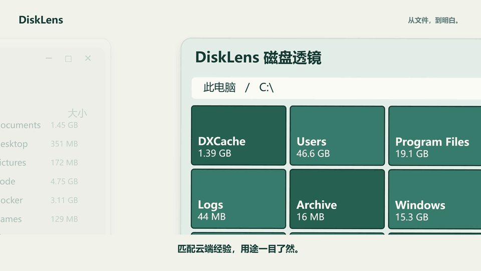
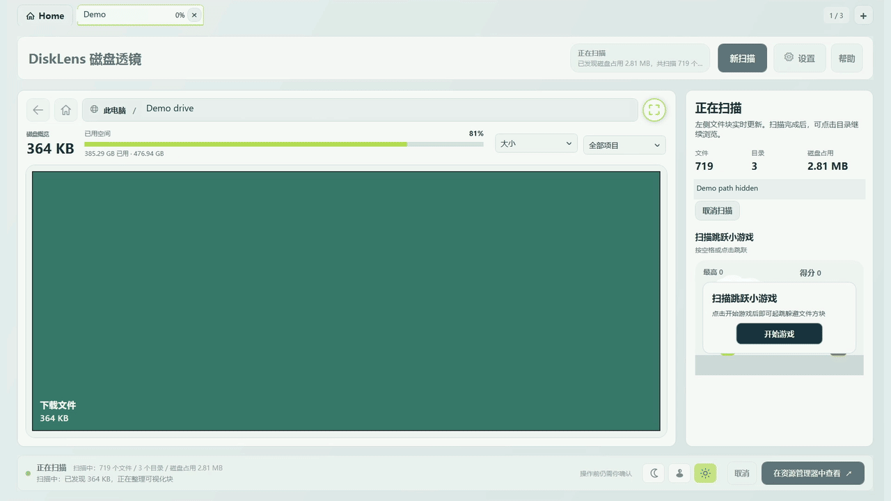
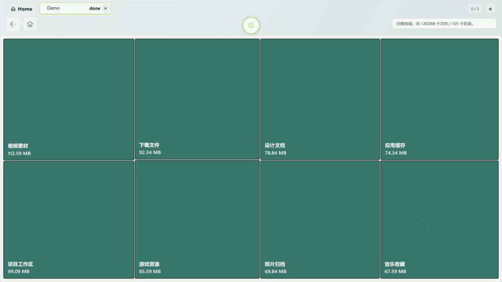
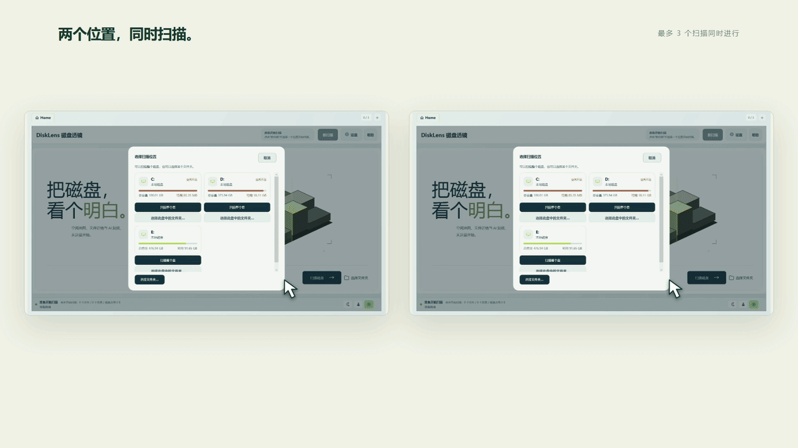

<div align="center">

# DiskLens · 磁盘透镜

**看清空间，从容整理。**

Windows 磁盘空间可视化工具，支持多任务扫描与可选的 AI 辅助分析。

[官网与下载](https://disklens.site/) · [历史发行](https://github.com/kxdyh/Disklens/releases) · [问题反馈](https://github.com/kxdyh/Disklens/issues) · [English](README.en.md)

Windows 10 / 11 · x64 · 免费使用

</div>

> **当前版本：1.1.2。** [官网下载安装包](https://disklens.site/) · [更新日志](CHANGELOG.md)。[1.0.0 预览版](https://github.com/kxdyh/Disklens/releases/tag/v2026.11.06-preview) 仍可从历史发行下载。



云端经验让文件块显示用途标签；双击进入下一层，悬浮看短用途，单击看详细分析。动图节选自宣传片，云端经验需主动启用，匹配成功的项目才会显示对应结论。

## 从空间占用，找到整理的起点

DiskLens 将文件与文件夹的磁盘占用绘制为矩形方块。先找到占用较大的位置，再逐层查看目录、比较大小，决定下一步如何处理。

| 功能 | 使用方式 |
| --- | --- |
| 磁盘空间可视化 | 扫描磁盘或文件夹，随着扫描进度更新占用视图 |
| 扫描报告 | 查看读取问题及原因，整盘扫描中单列 Windows 系统预留与剩余差额 |
| 多任务扫描 | 最多同时运行 3 个扫描任务，通过顶部标签切换查看 |
| 分层浏览与分页 | 每层优先呈现前 50 项，其余项目通过分页继续查看 |
| 专注视图 | 将空间图切换到全屏专注浏览，减少界面干扰 |
| 日夜主题 | 按使用习惯选择浅色或深色界面 |
| 可选 AI 分析 | 配置自己的 DeepSeek 或 OpenAI 兼容服务，主动发起辅助分析 |

进度按「已扫描的去重磁盘占用 ÷ 扫描开始时所在磁盘的已用空间」计算，文件夹扫描也使用所在磁盘已用空间作为分母。`done` 表示所选位置遍历完成；系统预留、NTFS 元数据、受限目录及扫描期间的空间变化，都可能使扫描占用与磁盘已用空间存在差额，因此完成时不一定显示 100%。

## 实机演示

以下为横屏录制的应用演示，每张动图依次展示浅色与深色界面。为便于阅读，录屏经过剪辑、变速和本机工作区路径遮盖；其中的扫描时长不代表性能基准，界面细节以当前发布版本为准。

**扫描与主题：扫描磁盘占用，切换浅色与深色界面。**



**专注浏览：从大目录进入下一层。**



**多任务：同时扫描两个位置，切换查看各自的进度与结果。**



## 下载与开始使用

1. 从 [官网](https://disklens.site/) 下载当前的 Windows x64 安装包。
2. 关闭正在运行的 DiskLens，再运行安装包。若使用旧版 ZIP，请完整解压后运行其中的 `DiskLens.App.exe`。
3. 选择要扫描的磁盘或文件夹，等待扫描完成后逐层浏览占用情况。
4. 如需 AI 辅助分析，在设置中配置自己的服务地址、模型和 API Key，再主动发起分析。

发布包适用于 Windows 10 / 11 x64，已包含运行环境。共享经验默认关闭；[共享经验说明](SHARED-EXPERIENCE.md) 介绍了匹配范围、隐私和开启方式。

## 数据与操作边界

- **扫描在本机进行。** 不使用 AI 也可以扫描与浏览磁盘占用。
- **AI 是可选项。** 只有你主动发起分析时，才会调用你配置的服务；分析相关信息会交给所选服务处理，请先确认该服务的数据政策。
- **API Key 由你自行配置。** 不要将密钥、完整个人路径或敏感文件信息提交到 Issue。
- **DiskLens 不会自动删除文件。** AI 结论仅供参考，整理前请核实文件用途并备份重要资料。

## 反馈问题与建议

欢迎任何用户在 [Issues](https://github.com/kxdyh/Disklens/issues) 中选择「问题反馈」「功能建议」或「使用咨询」。请提供应用版本、Windows 版本、复现步骤，以及脱敏后的截图。

扫描大小差异类问题，请说明扫描范围、对比工具，以及比较的是「大小」「占用空间」还是整个磁盘的已用空间。

如无法访问 Issues，或问题涉及不宜公开的内容，可联系 **[2297782581@qq.com](mailto:2297782581@qq.com)**。

## 源码与许可

DiskLens **可免费用于非商业用途**。本仓库的 DiskLens 源码按 [PolyForm Noncommercial License 1.0.0](LICENSE) 提供。商业用途需要另行取得作者授权，请通过 [版权说明](NOTICE.md) 中的联系方式咨询。配置的 AI 服务可能由服务商单独收费。

- [Windows 客户端](src/DiskLens.App)、[扫描与分析核心](src/DiskLens.Core)
- [云端经验公开服务](services/shared-knowledge)
- [官网贡献统计](services/site-stats)：每天两次生成匿名汇总快照。
- [中文使用指南](docs/releases/1.1-使用说明.md) · [English user guide](docs/releases/1.1-UserGuide.en.md)

### 构建 Windows 客户端

在 Windows 安装与 `global.json` 兼容的 .NET 8 SDK，到仓库根目录执行：

```powershell
dotnet build DiskLens.sln -c Release
dotnet publish src/DiskLens.App/DiskLens.App.csproj -c Release -r win-x64 --self-contained true -o artifacts/win-x64
```

`artifacts/win-x64/DiskLens.App.exe` 是可独立运行的源码构建版。需要转载或分发时，请一并提供 [LICENSE](LICENSE) 和 [NOTICE.md](NOTICE.md)。

### 作者独立维护的组件

作者保留不公开的运营控制台，仅用于发布新版本、发布公告和控制云端经验功能的新用户加入。加入控制不影响已开启功能的用户。控制台和管理凭据均不随源码或普通用户安装包分发。

官方发行版的「为爱发电」实现和赞赏码由作者独立维护。源码版可独立构建并使用核心功能。为防止赞赏码被替换，官方收款入口由作者审核维护，不接受通过 PR 修改。

作者：[kxdyh](https://github.com/kxdyh) · 官网：[disklens.site](https://disklens.site/)


[为爱发电 · 支持 DiskLens（打开赞赏码图片）](https://disklens.site/media/author-reward.png)
